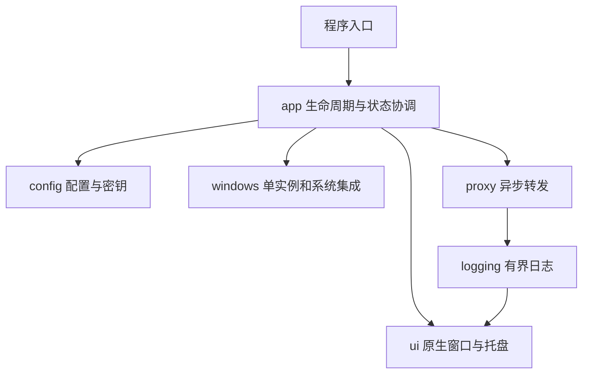

# 架构与模块职责

## 状态

当前已接入配置模型、Known Folder 目录发现、原子保存/备份、原生设置页及反向代理/SSE。后台控制线程独占 Tokio runtime 和代理句柄；GUI 用有界命令/事件队列及非阻塞定时轮询更新状态，不执行磁盘或网络操作。用户会话单实例、用量观察及四Tab日志已接入；日志worker串行处理轮转、尾读和清理，网络仅非阻塞投递类型化事件。当前还已接入DPAPI单文件密文、自启COM快捷方式、GUI子系统/CLI、正向代理/CONNECT/CORS、SQLite多维历史与原生趋势/筛选，以及一致快照迁移。历史与日志各有有界worker，网络仅提交脱敏元数据。依赖和事务路线见ADR0007，实际验收以STATUS为准。

## 模块边界

| 模块 | 职责 | 不应承担 |
|---|---|---|
| `app` | 生命周期、状态机、配置应用、命令协调 | HTTP 解析细节、控件绘制 |
| `config` | TOML、校验、目录、迁移、密钥存储 | 启停代理、更新控件 |
| `proxy` | 流式转发、SSE、CONNECT、认证、访问控制 | 等待 GUI、同步日志落盘 |
| `windows` | Mutex、命名管道、Known Folders、自启 | 代理业务判断 |
| `ui` | 原生窗口、控件、托盘、消息循环 | 阻塞网络和磁盘操作 |
| `logging` | 脱敏、轮转、有界消息与日志订阅 | 存储请求正文或真实凭据 |
| `history` | SQLite元数据、HMAC身份、后台查询/快照 | 真实Key、提示词和回复正文 |

`lib.rs` 提供可测试的模块边界，`main.rs` 仅作为程序入口；这仍然是一个 package，不拆 workspace。

Windows 专属模块通过 `cfg(windows)` 暴露。纯配置模型、协议规则和脱敏逻辑尽量保持可独立测试，跨平台测试不代表支持其他操作系统运行。

## 目标协调关系

图中箭头表示责任协调和数据流，不要求 Rust 模块建立同样的直接依赖。核心组件通过配置快照、控制消息及状态事件交互，具体接口随功能实施确定。

## 并发与安全边界

- Win32 消息循环拥有 UI 对象；网络任务不直接操作控件。
- 异步运行时负责网络，不等待 UI 响应或磁盘日志完成。
- 状态和日志消息队列有界，统计刷新允许合并，避免逐个数据块通知 UI。
- `app` 是运行状态的权威来源，UI 不用按钮文本判断代理是否启动。
- 文件保存、目录迁移和系统集成不能阻塞消息循环。
- 上游凭据与客户端认证分离，凭据只绑定可信上游 origin。
- Windows FFI 封装在必要边界，显式说明所有权、句柄生命周期及线程约束。

## 验证与剩余设计

- 当前具体依赖由Cargo.lock固定；Tokio/Hyper/Rustls和系统根已接入。
- 已有静态CRT预览包及PE导入检查，仍需干净Windows验证及许可证审核。
- 真实HTTPS成功握手、多用户/提权、长稳和完整多屏/辅助功能仍需验收。
- 历史的模型提取、完整时区/排序/别名和保留设置仍待完善。

上述内容在首次引入相关依赖或行为时编写 ADR，不提前以未经验证的构建参数固定实现。
